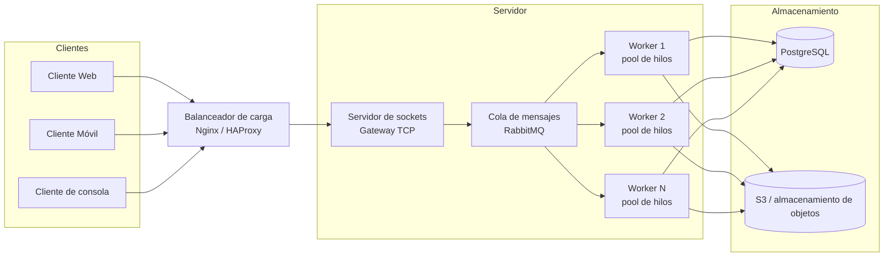

# Arquitectura distribuida (PFO3)

## Flujo de una petición

1. El cliente (web, móvil o consola) abre una conexión TCP al balanceador.
2. El balanceador distribuye la conexión a un servidor gateway.
3. El gateway recibe el mensaje con framing por longitud, lo valida y lo publica en la cola de mensajes (RabbitMQ).
4. Un worker libre consume el mensaje, ejecuta la operación de dominio (registro, login, CRUD de tareas) contra PostgreSQL/S3.
5. El worker publica el resultado en la cola de respuestas (o responde por el canal de la conexión).
6. El gateway devuelve el resultado al cliente y cierra (o mantiene) la conexión.